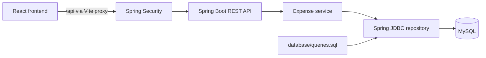

# Kharcha Paani

**A clear picture of your spending. A little more peace of mind.**

Kharcha Paani is a full-stack monthly expense manager that helps you plan a budget, track everyday spending, and see where your money goes. Built with **React, Spring Boot, and MySQL**, it combines an INR expense dashboard with account-based data isolation and persistent storage.

The project also demonstrates core DBMS concepts through handwritten SQL, relational constraints, transactions, joins, aggregation, and indexes. All application queries are available in a single [SQL catalog](database/queries.sql), executed directly through Spring JDBC.

## Contents

- [Features](#features)
- [Tech stack](#tech-stack)
- [Architecture](#architecture)
- [Project structure](#project-structure)
- [Getting started](#getting-started)
- [Configuration](#configuration)
- [Database design](#database-design)
- [API overview](#api-overview)
- [Sample data](#sample-data)
- [Testing](#testing)
- [Build and run](#build-and-run)
- [Troubleshooting](#troubleshooting)
- [Documentation](#documentation)

## Features

- **Personal accounts:** register, log in, and log out using session-based authentication and BCrypt password hashing.
- **Monthly budgets:** set or update an independent budget for each calendar month, including a zero budget.
- **Expense management:** add, edit, and delete expenses with a description, amount, date, and category.
- **Custom categories:** create categories while entering an expense; existing names are reused case-insensitively within your account.
- **Spending overview:** view the monthly budget, total spent, remaining balance, and budget progress.
- **Expense exploration:** browse category totals and a category chart, search expenses, and filter by category.
- **Month navigation:** revisit previous months or record expenses for future dates.
- **INR formatting:** display amounts in Indian rupees with two decimal places.
- **Responsive interface:** use the app on desktop and mobile, with keyboard-accessible dialogs and animated visual details.
- **Persistent records:** accounts, budgets, categories, and expenses are stored in MySQL and remain available after restarting the app.

You can record expenses before setting a budget. Overspending is allowed and produces a negative remaining balance. Budgets and balances do not carry forward between months; categories remain available across an account's months.

## Tech stack

| Layer | Technologies |
| --- | --- |
| Frontend | React 19, Vite 6, Tailwind CSS 4, custom CSS |
| UI and motion | Lucide React, GSAP, Outfit and Fraunces fonts |
| Backend | Java 21, Spring Boot 3.5, Spring Web, Bean Validation |
| Authentication | Spring Security, BCrypt, HTTP sessions, CSRF protection |
| Data access | Spring JDBC with `NamedParameterJdbcTemplate` |
| Database | MySQL, InnoDB, handwritten SQL |
| Testing | Node.js test runner, Vitest, React Testing Library, JUnit, Spring Boot Test, Spring Security Test |
| Build tools | npm, Maven |

## Architecture



The browser talks to the backend through relative `/api` requests. During local development, Vite proxies these requests to port `8080`, keeping authentication cookies and CSRF requests on the same browser origin.

The backend validates input, derives the current user from the server session, and executes parameterized SQL. Financial calculations use Java `BigDecimal` and MySQL `DECIMAL(12,2)`. Creating a category and saving its expense happen in the same transaction.

Maven packages [database/schema.sql](database/schema.sql) and [database/queries.sql](database/queries.sql) as backend resources. Edit the originals in `database/` and restart or rebuild the backend; files under `backend/target/` are generated.

## Project structure

```text
.
├── backend/
│   ├── pom.xml
│   └── src/
│       ├── main/
│       │   ├── java/com/kharchapaani/  # Controllers, security, service, repository
│       │   └── resources/             # Spring Boot configuration
│       └── test/java/com/kharchapaani/ # Unit, API, startup, and MySQL tests
├── database/
│   ├── schema.sql                     # Tables, keys, constraints, and indexes
│   ├── queries.sql                    # Named SQL queries used by the backend
│   └── sample_data.sql                # Optional records for an existing account
├── docs/
│   ├── API.md                         # API contract and authentication flow
│   ├── ER-diagram.md                  # Entity relationships and design notes
│   └── verification.md                # Historical verification notes
├── frontend/
│   ├── public/                        # Static assets
│   ├── src/
│   │   ├── components/                # Authentication, dashboard, forms, dialogs
│   │   ├── App.jsx                    # Application state and API coordination
│   │   └── lib.js                     # API client, formatting, validation
│   ├── tests/                         # Component and interaction tests
│   ├── package.json
│   └── vite.config.js                 # Development server and API proxy
├── .env.example                       # Backend environment variable reference
├── .gitignore
└── README.md
```

## Getting started

### Prerequisites

| Tool | Requirement |
| --- | --- |
| Java | JDK 21 or newer; the project targets Java 21 bytecode |
| Maven | 3.6.3 or newer |
| Node.js | 22.12+ on the 22.x line, or 24.x / 26+; required by the included Vitest version |
| npm | Available with your Node.js installation |
| MySQL | 8.0.16 or newer, running locally or on a reachable host |
| Database client | MySQL CLI or MySQL Workbench |

Clone or download the repository and open a terminal in its root directory. The commands below use a Bash or Zsh shell.

### 1. Prepare MySQL

Connect as a MySQL administrator and run the following, replacing the example password:

```sql
CREATE DATABASE IF NOT EXISTS kharcha_paani
    CHARACTER SET utf8mb4 COLLATE utf8mb4_0900_ai_ci;

CREATE USER 'kharcha_app'@'localhost'
    IDENTIFIED BY 'choose_your_own_password';

GRANT SELECT, INSERT, UPDATE, DELETE, CREATE, REFERENCES
    ON kharcha_paani.* TO 'kharcha_app'@'localhost';
```

If you already have a database user, grant that user the required permissions instead of creating it again. For a remote MySQL server, use the appropriate account host.

On startup, the backend creates the configured database if permissions allow, then applies `schema.sql` to create missing tables. Existing records are preserved, and sample data is never loaded automatically. `CREATE TABLE IF NOT EXISTS` does not migrate older table definitions.

For optional manual table creation, run this from the repository root:

```sh
mysql -u kharcha_app -p kharcha_paani < database/schema.sql
```

In MySQL Workbench, select `kharcha_paani` as the default schema before executing `database/schema.sql`.

### 2. Start the backend

From the repository root:

```sh
cd backend
export DB_HOST=localhost
export DB_PORT=3306
export DB_NAME=kharcha_paani
export DB_USERNAME=kharcha_app

# Enter your MySQL password when prompted; input stays hidden.
printf 'MySQL password: '
read -r -s DB_PASSWORD
export DB_PASSWORD
printf '\n'

mvn spring-boot:run
```

The API runs at **http://localhost:8080**. MySQL must be reachable with valid credentials and the required permissions; connection or schema initialization failures stop startup and appear in the backend terminal.

The database password belongs to your MySQL user. You will create separate credentials for your account inside the app.

### 3. Start the frontend

Open a second terminal at the repository root:

```sh
cd frontend
npm ci
npm run dev
```

Open **[http://127.0.0.1:5173](http://127.0.0.1:5173)**. Use this address consistently so the browser keeps the same session origin.

### 4. Create an account

Select **Create account**, choose a username and password, and add your first expense. Set a monthly budget to see your remaining balance and spending progress.

- Usernames contain 3–32 ASCII letters, digits, or underscores and are stored lowercase.
- Passwords contain 8–72 characters and must fit within 72 UTF-8 bytes.
- Logging out or restarting the backend preserves financial records. Backend restarts end login sessions, so sign in again with the same account.

## Configuration

Set these environment variables in the terminal that starts Spring Boot:

| Variable | Default | Purpose |
| --- | --- | --- |
| `DB_HOST` | `localhost` | MySQL hostname |
| `DB_PORT` | `3306` | MySQL port |
| `DB_NAME` | `kharcha_paani` | Application database |
| `DB_USERNAME` | `kharcha_app` | MySQL username |
| `DB_PASSWORD` | Empty | MySQL password; set it for your database user |
| `PORT` | `8080` | Backend HTTP port |

[.env.example](.env.example) is a configuration reference. **Spring Boot does not automatically load `.env` files.** Export the variables in your shell or configure them in your IDE's run configuration. Local environment files, dependencies, and build output are covered by [.gitignore](.gitignore).

If you change `PORT`, update the development and preview proxy targets in [frontend/vite.config.js](frontend/vite.config.js). For an existing installation, keep `DB_NAME` and `DB_USERNAME` pointed at the database that holds your saved records.

## Database design

The schema uses four related tables:

| Table | Stores | Key rules |
| --- | --- | --- |
| `users` | Usernames, password hashes, creation timestamps | Unique username |
| `monthly_budgets` | A user's budget for a calendar month | Unique `(user_id, budget_month)`; nonnegative amount |
| `categories` | Category names owned by each user | Unique `(user_id, name)` |
| `expenses` | Description, amount, date, owner, and category | Positive amount; category must belong to the same user |

The database demonstrates:

- **Primary, foreign, and composite keys** for entity identity and referential integrity.
- **Unique and check constraints** for usernames, categories, monthly budgets, and valid amounts.
- **Joins and aggregation** for category totals using `JOIN`, `GROUP BY`, `SUM`, and `COUNT`.
- **Transactions** to keep related writes consistent and roll back partial changes.
- **Indexes** such as `(user_id, expense_date)` for account-specific monthly queries.
- **Derived summaries:** totals and remaining balances are calculated rather than stored separately.

Monthly queries use an inclusive start date and exclusive end date. Every query accessing financial records is scoped to the authenticated user, and a composite foreign key prevents an expense from referencing another user's category.

SQL queries use JDBC named parameters such as `:userId`, `:start`, and `:end`. When demonstrating them in Workbench, replace these placeholders with an actual user ID and quoted dates.

See the [ER diagram and relationship notes](docs/ER-diagram.md) and the [complete schema](database/schema.sql).

## API overview

All routes use the `/api` prefix. Requests and responses use JSON where a body is present.

| Method | Endpoint | Purpose |
| --- | --- | --- |
| `GET` | `/api/auth/csrf` | Obtain a CSRF token |
| `POST` | `/api/auth/register` | Create an account |
| `POST` | `/api/auth/login` | Sign in and establish a session |
| `GET` | `/api/auth/me` | Get the current user |
| `POST` | `/api/auth/logout` | End the current session |
| `GET` | `/api/categories` | List the user's categories |
| `GET` / `PUT` | `/api/budgets/{YYYY-MM}` | Read or save a monthly budget |
| `GET` | `/api/expenses?month=YYYY-MM` | List expenses for a month |
| `POST` | `/api/expenses` | Create an expense |
| `PUT` / `DELETE` | `/api/expenses/{id}` | Update or delete an owned expense |
| `GET` | `/api/dashboard?month=YYYY-MM` | Read monthly totals and category breakdown |

For example, creating an expense accepts:

```json
{
  "description": "Lunch with a friend",
  "amount": "240.50",
  "expenseDate": "2026-10-28",
  "categoryName": "Food & drinks"
}
```

Authenticated requests use an HttpOnly session cookie with `SameSite=Lax`. Every `POST`, `PUT`, and `DELETE`, including login and registration, requires the CSRF header returned by `/api/auth/csrf`. Fetch a new token after login; the frontend handles this automatically. Sessions expire after 12 hours of inactivity.

See [docs/API.md](docs/API.md) for response examples, validation rules, error codes, and the complete session flow.

## Sample data

To explore the app with example records:

1. Register an account named `demo` through the app.
2. From the repository root, run:

   ```sh
   mysql -u kharcha_app -p kharcha_paani < database/sample_data.sql
   ```

3. Refresh the dashboard and select the current month.

The script adds a ₹15,000 budget if none exists, three categories, and sample expenses for the current month. It uses the existing account and never inserts a plaintext password. Existing budgets are preserved, and rerunning the script avoids duplicate sample expenses in normal use.

If you use a different database name or account, update `USE kharcha_paani` and `@demo_username` in [database/sample_data.sql](database/sample_data.sql) before running it.

## Testing

### Frontend

```sh
cd frontend
npm test
```

The tests cover currency and date helpers, decimal validation, budget edge cases, dashboard search and filters, expense forms, dialog interactions, authentication flows, and animated authentication content. Component tests use mocked API responses.

### Backend

```sh
cd backend
mvn test
```

Unit, API, and startup tests cover password handling, authentication, CSRF, validation, ownership checks, exact balances, SQL catalog loading, schema initialization, and database error handling. These tests run without MySQL. Actual MySQL integration tests are opt-in and skipped by default.

### Optional MySQL integration tests

Create a separate test database as a MySQL administrator:

```sql
CREATE DATABASE kharcha_paani_test
    CHARACTER SET utf8mb4 COLLATE utf8mb4_0900_ai_ci;

GRANT SELECT, INSERT, UPDATE, DELETE, CREATE, REFERENCES
    ON kharcha_paani_test.* TO 'kharcha_app'@'localhost';
```

From `backend/`, with your database connection variables already exported:

```sh
TEST_DB_NAME=kharcha_paani_test mvn test
```

The name must end in `_test`. These tests verify real SQL behavior, decimal sums, category reuse, month and leap-day boundaries, CRUD operations, username uniqueness, and cross-user isolation. Test records are rolled back; use a dedicated database because startup still creates missing tables.

### Manual acceptance checks

1. Register two accounts and check that each sees only its own data.
2. Set a budget, add expenses in multiple categories, and verify totals.
3. Go over budget and confirm the remaining balance becomes negative.
4. Edit and delete expenses, then check the updated category totals.
5. Switch months and confirm that budgets and expense lists are independent.
6. Refresh, log out and back in, and restart the backend to confirm persistence.
7. Check the mobile layout and keyboard navigation through dialogs.

## Build and run

Build the frontend from `frontend/`:

```sh
npm run build
npm run preview
```

The compiled files are written to `frontend/dist/`. Open the preview URL printed by Vite; its preview server also proxies `/api` to the backend.

Package and run the backend from `backend/`, with your database environment variables set:

```sh
mvn package
java -jar target/kharcha-paani-1.0.0.jar
```

The executable JAR contains the backend and SQL resources. The frontend is built and served separately. For deployment, serve the frontend assets and route `/api` to Spring Boot through your hosting or reverse-proxy configuration.

## Troubleshooting

| Problem | What to check |
| --- | --- |
| Backend cannot connect to MySQL | Confirm MySQL is running and check `DB_HOST`, `DB_PORT`, `DB_USERNAME`, and `DB_PASSWORD` in the backend terminal. Restart after changing variables. |
| Database or tables are missing | Check `DB_NAME` and grant the app user `CREATE` and `REFERENCES` permissions as well as CRUD access, then restart the backend. |
| MySQL rejects credentials | Use the actual MySQL username. A saved Workbench connection's display name is only a label. |
| Frontend cannot reach the API | Start Spring Boot on port `8080`, or update both proxy targets if using another port. |
| A request returns `403` | Retry to fetch a fresh CSRF token, or refresh and sign in again. |
| Port `5173` is already in use | Stop the process using it. The development server uses a fixed port with `strictPort` enabled. |
| Saved records seem to be missing | Verify that the backend is connected to the original database and that you are signed into the correct account and month. |
| Frontend tests reject the Node version | Use a Node version supported by the included Vitest release; see prerequisites. |

## Documentation

- [API reference](docs/API.md) — request and response formats, sessions, CSRF, and validation.
- [ER diagram](docs/ER-diagram.md) — relationships, constraints, ownership, and normalization notes.
- [Database schema](database/schema.sql) — table definitions, keys, checks, and indexes.
- [Application queries](database/queries.sql) — the named SQL statements executed by the backend.
- [Verification history](docs/verification.md) — previous checks and their stated limitations.
