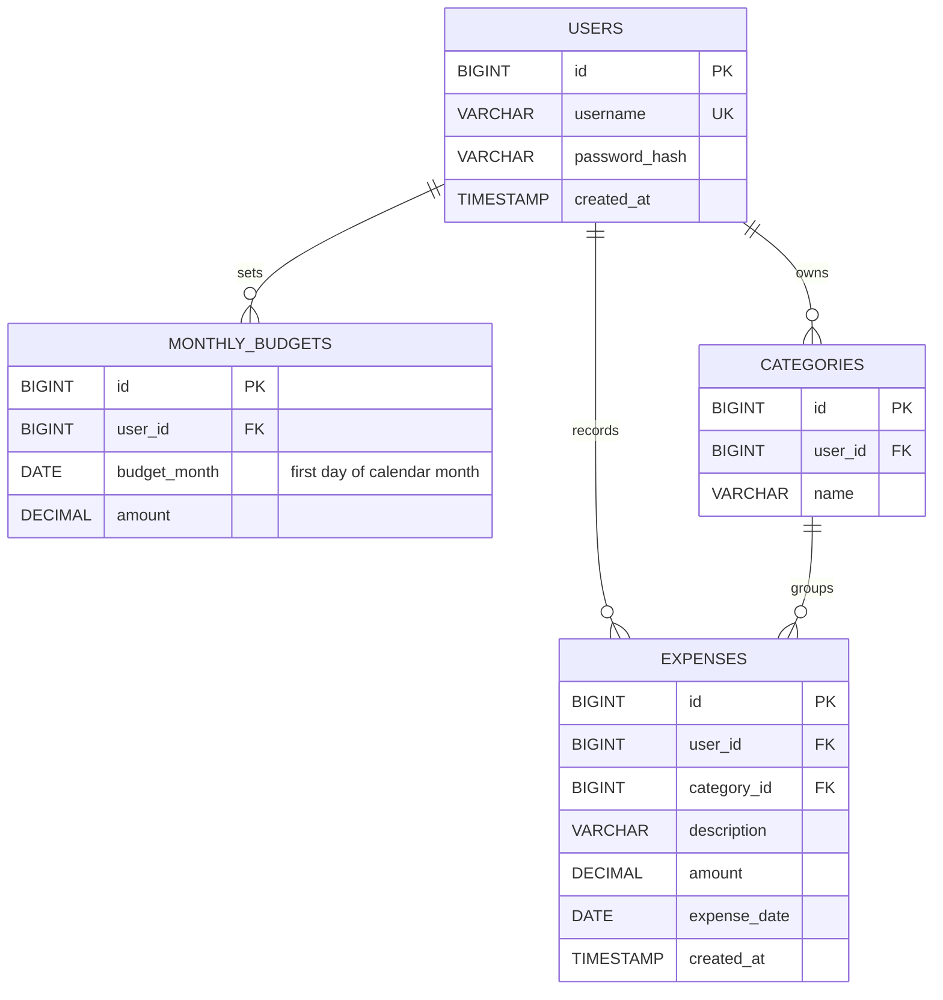

# Kharcha Paani — entity relationships

## Constraints and normalization

- Each user owns many monthly budgets, categories, and expenses.
- `(user_id, budget_month)` is unique; every month gets an independent budget.
- `(user_id, name)` is unique in categories. MySQL's `utf8mb4_0900_ai_ci` collation makes category and username comparisons case-insensitive and accent-insensitive.
- Category ownership is also protected by a composite foreign key: `expenses(category_id, user_id)` references `categories(id, user_id)`.
- Financial amounts use `DECIMAL(12,2)`, not floating-point storage. Budgets must be nonnegative; expenses must be positive.
- Budgets store the first day of the month as a SQL `DATE`. Expense dates are calendar dates. Creation timestamps use the database connection's UTC session.
- The design separates users, budgets, categories, and expenses. Category names are stored once per user rather than repeated in every expense. Totals and remaining balances are derived instead of stored, avoiding stale summaries.
- The expense owner is intentionally repeated alongside the category ID to make ownership filtering and the composite ownership constraint explicit.
- The `(user_id, expense_date)` index supports month queries. Inclusive start/exclusive end boundaries avoid applying functions to the indexed date column.

The exact DDL is in `database/schema.sql`. The actual parameterized application queries are in `database/queries.sql`.
